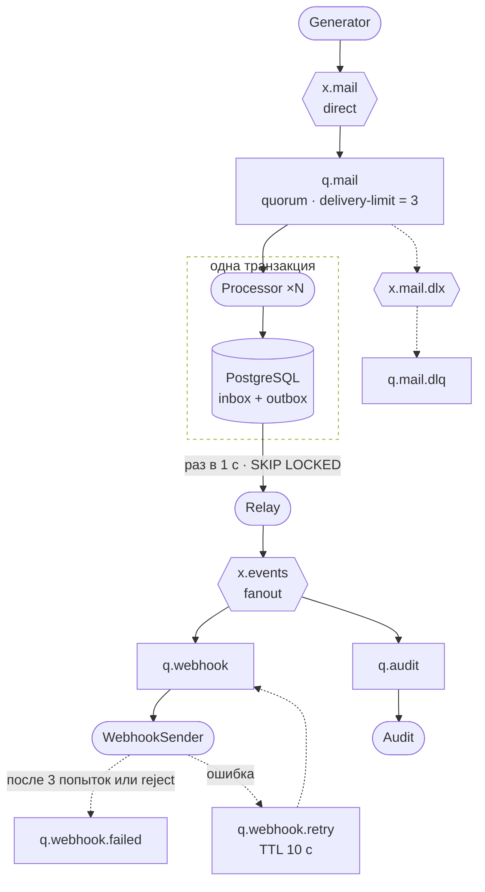

# MailPipeline — учебный конвейер входящих писем на RabbitMQ

> **In English:** a hands-on learning project in C# / .NET 10. It shows RabbitMQ 4.3 messaging patterns in a small email-processing pipeline: manual ack/nack/reject, quorum queues with `x-delivery-limit`, dead-letter exchanges, delayed retry via TTL + DLX, publisher confirms, and the transactional Inbox/Outbox patterns on PostgreSQL. The documentation is in Russian.

Упрощённая модель обработки входящей почты в сервисе email-рассылок: письма скачиваются (аналог работы по POP3/IMAP) и обрабатываются, а на ответы клиентам уходят вебхуки. Проект написан, чтобы на практике разобраться в ключевых темах работы с брокером сообщений:

- exchange (direct, fanout), очереди, binding и routing key;
- ручные `ack` / `nack` / `reject`;
- prefetch и конкурирующие потребители;
- доставка "как минимум один раз" (at-least-once) и идемпотентный потребитель (**Inbox**);
- транзакционный **Outbox**;
- quorum-очереди, `x-delivery-limit` и dead-letter exchange;
- повтор с задержкой через TTL + DLX, parking lot;
- publisher confirms;
- Publish/Subscribe паттерн: одно событие — несколько независимых подписчиков.

Проект рассчитан на **RabbitMQ 4.3**: в этой версии поменялось, как quorum-очередь считает неудачные доставки (см. [ack, nack, reject](#подтверждения-потребителя-ack-nack-reject)).

Содержание:

1. [Схема](#схема)
2. [RabbitMQ: основные понятия](#rabbitmq-основные-понятия)
3. [Топология проекта](#топология-проекта)
4. [Путь одного письма](#путь-одного-письма)
5. [Компоненты](#компоненты)
6. [Гарантии доставки: зачем Inbox и Outbox](#гарантии-доставки-зачем-inbox-и-outbox)
7. [Инфраструктура: docker-compose](#инфраструктура-docker-compose)
8. [Запуск](#запуск)
9. [Что смотреть в management UI](#что-смотреть-в-management-ui)
10. [Эксперименты](#эксперименты)
11. [Сознательные упрощения](#сознательные-упрощения)
12. [Лицензия](#лицензия)

## Схема



Обозначения: `x.*` — exchange, `q.*` — очередь, `[...]` — наш процесс (`dotnet run -- <режим>`).

## RabbitMQ: основные понятия

RabbitMQ — это **брокер сообщений**: посредник, который принимает сообщения от одних программ, хранит их и раздаёт другим. Отправитель и получатель не знают друг о друге и не обязаны работать одновременно: если получатель выключен, сообщения ждут его в очереди.

### Программы-участники

| Понятие | Что это | В проекте |
|---|---|---|
| **Producer** (издатель) | Программа, которая публикует сообщения | Generator, Relay, WebhookSender (при повторных попытках отправки) |
| **Consumer** (потребитель) | Программа, которая подписана на очередь и получает из неё сообщения | Processor, WebhookSender, Audit |
| **Connection** | TCP-соединение с брокером. Дорогое, обычно одно на процесс | `Rabbit.ConnectAsync` |
| **Channel** | Лёгкое "виртуальное соединение" внутри connection, через него идут все операции | `Rabbit.CreateChannelAsync`; у WebhookSender два канала: для чтения и для публикации |

### Exchange, очередь, binding, routing key

**Издатель никогда не пишет напрямую в очередь.** Он отправляет сообщение в exchange с routing key (строкой-меткой), а exchange по своим правилам решает, в какие очереди положить копии.

- **Exchange (обменник / маршрутизатор)** — принимает сообщения от издателя и распределяет их по очередям. Сам ничего не хранит: если подходящей очереди нет, сообщение безвозвратно теряется (если не настроена обработка недоставленных сообщений через альтернативный обменник Alternate Exchange или возврат издателю с помощью флага `mandatory`);
- **Queue (очередь)** — место, где хранятся сообщения, пока их не заберёт и не подтвердит (`ack`) потребитель;
- **Binding (привязка)** — логическая связь между Exchange и очередью. Определяет, в какую именно очередь (или очереди) должно попасть сообщение;
- **Routing key (ключ маршрутизации)** — специальная метка (строка), которую издатель прикрепляет к сообщению при отправке в Exchange. Маршрутизатор сверяет этот ключ с привязками (binding key) и на основе совпадения определяет, в какую именно конкретную очередь (или несколько очередей сразу) должно уйти сообщение;
- **Binding key (ключ привязки)** — шаблон или аргумент, указываемый при создании Binding (связи). Exchange сопоставляет Routing key сообщения с Binding key очереди, чтобы принять решение о маршрутизации (актуально для типов topic и direct).
>**Примечание:** В официальном референсе RabbitMQ этот параметр называют _binding key_, однако в коде библиотеки `RabbitMQ.Client` (например, в методе `QueueBindAsync`) аргумент исторически называется `routingKey`. Важно их не путать: при связывании очереди мы указываем _binding key_, а при отправке сообщения — _routing key_.

| Тип exchange | Правило | В проекте |
|---|---|---|
| **direct** | В очереди, у которых **Binding key точно равен Routing key** | `x.mail` с ключом `mail` → отправляет строго в очередь `q.mail`. |
| **fanout** | Сообщение **копируется во все привязанные очереди**, а Routing Key полностью игнорируется. |**Широковещание:** `x.events` дублирует события в `q.webhook` и `q.audit`. Также используется для инфраструктуры ошибок: `x.mail.dlx` → `q.mail.dlq`.|
| **default** (`""`) | Встроенный `direct` exchange. Каждая созданная очередь **автоматически привязывается к нему**, а её имя становится ключом привязки. | Повторы WebhookSender; возврат из `q.webhook.retry`; негодные события из `q.webhook` в `q.webhook.failed` |

Дублирование сообщений при совпадении привязок — это базовое свойство любого Exchange. Паттерн Publish/Subscribe на базе fanout является лишь частным случаем, когда привязка безусловна. 

Текущий выбор **fanout** для `x.events` оправдан, пока все потребители обрабатывают полный поток событий. При этом сервис Relay уже сейчас публикует сообщения с Routing Key, отражающим тип события. Это гарантирует бесшовную миграцию на **topic-обменник** в будущем без изменения кода издателя: достаточно обновить правила привязок брокера. Например, очередь `q.webhook` сможет подписаться только на `ReplyReceived`, а `q.audit` продолжит собирать все события по шаблону `#`. Использование типа `headers` в данном сценарии избыточно.

### Конфигурация очередей
#### 1. Базовые свойства (флаги)

* **durable** — очередь переживает перезапуск брокера. Для quorum-очередей durable обязателен: объявить quorum-очередь с durable=false брокер не даст.
* **exclusive / autoDelete** — монопольный доступ одного соединения (очередь удаляется при его закрытии) / удаление после ухода последнего потребителя. Нужны для временных очередей; quorum-очереди их не поддерживают.

#### 2. Тип очереди

* `x-queue-type` — **classic** (по умолчанию) или **quorum**. Узел RabbitMQ у нас один и реплик нет, но мы используем quorum: они всегда пишут сообщения на диск независимо от delivery_mode, поддерживают at-least-once dead-lettering и лимит повторных доставок.

#### 3. Дополнительные аргументы (x-arguments)

* `x-dead-letter-exchange / x-dead-letter-routing-key`— куда и с каким ключом отправлять "мёртвые" сообщения.
* `x-dead-letter-strategy` (только quorum) — at-most-once (по умолчанию) или at-least-once. Режим at-least-once гарантирует доставку в DLX, но требует `x-overflow: reject-publish`: без него ошибки не будет, очередь молча работает в at-most-once.
* `x-message-ttl `— сколько миллисекунд сообщение может пролежать в очереди до удаления/DLX.
* `x-delivery-limit` (только quorum) — лимит неудачных доставок, после которого сообщение отправляется в DLX (без DLX — удаляется). С версии 4.0 по умолчанию равен 20, `-1` отключает лимит (не рекомендуется).

#### Идемпотентность объявления
Объявление (`ExchangeDeclare`, `QueueDeclare`, `QueueBind`) идемпотентно: если объект уже есть с теми же параметрами, ничего не происходит. Поэтому каждый микросервис вызывает `Rabbit.DeclareTopologyAsync` при старте, и порядок их запуска не важен.
> **Важно:** Объявление существующей очереди с другими аргументами падает с ошибкой PRECONDITION_FAILED. Если поменяли конфигурацию в коде, старую очередь нужно удалить через Management UI или сбросить тома командой `docker compose down -v`.

### Сообщение

Сообщение = **тело** (у нас JSON в байтах) + **свойства** (метаданные). Свойства задаёт `Rabbit.GetProps`:

- `Persistent = true` — брокер пишет сообщение на диск, и оно переживает перезапуск (в durable classic-очереди; quorum пишет на диск всё);
- `MessageId` — уникальный id **этого** сообщения, по нему потребители распознают дубли (Inbox). У письма это id письма, у события — свой `EventId`;
- `ContentType` — подсказка, как читать тело;
- `Type` — тип события (`ReplyReceived`), его ставит Relay; по нему WebhookSender пропускает события других типов;
- `Headers` — произвольные заголовки. WebhookSender хранит в `attempt` номер попытки, а quorum-очередь сама добавляет `x-delivery-count` — число прошлых неудачных доставок (при первой доставке его нет).

Тело разбирается строго (`Models.cs`): сообщение без обязательного поля, с `null` вместо строки или с неизвестным `Kind` считается негодным.

### Подтверждения потребителя: ack, nack, reject

Выданное потребителю сообщение брокер **не удаляет**, а помечает как *unacked*. Потребитель обязан ответить ровно один раз на каждую доставку. Вариантов четыре (`OutcomeStatus` в `Rabbit.cs`):

| Ответ | Смысл | Что делает брокер | Когда в проекте |
|---|---|---|---|
| `ack` | успешно обработал | удаляет сообщение | успех, дубль, событие другого типа |
| `nack`, `requeue: true` | не смог **сейчас**, причина не в сообщении | возвращает в очередь; в `x-delivery-limit` **не засчитывается** | недоступна БД или брокер |
| `reject`, `requeue: true` | обработка **не удалась** | возвращает в очередь и засчитывает неудачную доставку; после лимита — в DLX | письмо `Broken`, непредвиденная ошибка |
| `reject`, `requeue: false` | сообщение заведомо негодное | сразу в DLX (если DLX нет — удаляет) | тело не разбирается |

Разница между `nack` и `reject` появилась в RabbitMQ 4.3: раньше в `x-delivery-count` засчитывались оба. Ловушка: если отвечать на "битое" сообщение `nack(requeue: true)`, оно будет возвращаться в очередь бесконечно и до DLQ дойдёт только по `x-message-ttl`, а не по лимиту доставок. С `requeue: false` оба метода отправляют сообщение в DLX сразу.

Если потребитель **упал или закрыл соединение**, не ответив, брокер возвращает его неподтверждённые сообщения в очередь и засчитывает им неудачную доставку. Сообщение не теряется, но может прийти **повторно** — это и есть доставка "как минимум один раз" (at-least-once).

Ещё одна ловушка: исключение из `ReceivedAsync` клиент проглатывает (только вызывает `CallbackExceptionAsync`), а сообщение остаётся без ответа и занимает слот prefetch. Когда все слоты заняты, потребитель молча перестаёт получать сообщения. Поэтому обработчики ничего не бросают: сначала решают, чем ответить, потом отвечают через `Rabbit.RespondAsync`.

Везде `autoAck: false`. С `autoAck: true` брокер удалял бы сообщение в момент выдачи, и падение посреди обработки означало бы потерю письма.

### Prefetch и конкурирующие потребители

Если на очередь подписано несколько потребителей, брокер раздаёт сообщения **по очереди между ними** (round-robin): каждое получает только один. Это "конкурирующие потребители" — так масштабируют обработку.

**Prefetch** (`BasicQos`, `prefetchCount`) — сколько неподтверждённых сообщений брокер может выдать одному потребителю заранее. Без него брокер выгрузил бы всю очередь первому подключившемуся. Prefetch: Processor — 10, WebhookSender — 5, Audit — 10.

### Подтверждения издателя: publisher confirms и mandatory

- **Publisher confirms** — брокер подтверждает, что сообщение надёжно сохранено. С включёнными confirms `BasicPublishAsync` ждёт подтверждения, а при отказе бросает исключение. Без них публикация — "отправил и забыл".
- **`mandatory: true`** — если exchange не нашёл ни одной очереди, брокер возвращает сообщение издателю (в нашем клиенте — исключение), а не выбрасывает молча.

Confirms включены у Generator, Relay и у канала публикации WebhookSender.

### Dead-letter exchange (DLX) и TTL

Сообщение становится **"мёртвым"** (dead letter), когда:

- потребитель ответил `reject` / `nack` с `requeue: false`;
- истёк TTL (`x-message-ttl`);
- в quorum-очереди превышен `x-delivery-limit`;
- очередь переполнена (в проекте не используется).

Если у очереди задан `x-dead-letter-exchange`, мёртвое сообщение публикуется туда — с исходным routing key или с `x-dead-letter-routing-key`. Брокер пишет в заголовок `x-death`, откуда и почему оно умерло (`rejected`, `expired`, `delivery_limit`); первая причина дублируется в `x-first-death-reason`. Без DLX мёртвое сообщение удаляется.

**Надёжность перекладывания.** По умолчанию dead-lettering работает по схеме at-most-once: брокер удаляет сообщение и публикует в DLX без подтверждений, и если подходящей очереди нет, оно пропадает. Quorum-очереди умеют `at-least-once`: сообщение остаётся в исходной очереди, пока целевая не подтвердит приём. Поэтому у `q.mail` и `q.webhook` заданы `x-dead-letter-strategy: at-least-once` и `x-overflow: reject-publish`. Classic-очередь `q.webhook.retry` перекладывает сообщения только в режиме at-most-once.

DLX в проекте используется тремя способами:

1. **Склад отравленных сообщений.** Письмо `Broken` раз за разом получает `reject` с requeue, после превышения лимита `q.mail` отправляет его через `x.mail.dlx` в `q.mail.dlq`. Неразбираемое тело попадает туда с первой доставки. Там письмо ждёт человека и не мешает остальным.
2. **Повтор с задержкой.** У `q.webhook.retry` **нет потребителей** и TTL = 10 с. Через 10 с сообщение "умирает" и по DLX-настройкам возвращается в `q.webhook`.
3. **Parking lot.** `q.webhook.failed` — для сообщений, от которых отказались: вебхук не ушёл за 3 попытки (копию кладёт WebhookSender, с заголовком `attempt`) или событие негодное (приходит через DLX `q.webhook`, с `x-death`). Читает её только человек.

`q.mail.dlq` и `q.webhook.failed` — quorum-очереди, поэтому сообщения, ждущие разбора (даже опубликованные из UI без `Delivery mode: 2`), переживают рестарт брокера.

В RabbitMQ 4.3 у quorum-очередей есть и встроенный delayed retry с нарастающей паузой. Связка TTL + DLX работает в любой версии и наглядно показывает dead-lettering, поэтому здесь используется она.

## Топология проекта

Вся топология объявляется в `Rabbit.DeclareTopologyAsync` (`Rabbit.cs`).

| Exchange | Тип | Кто публикует | Куда ведёт |
|---|---|---|---|
| `x.mail` | direct | Generator (ключ `mail`) | `q.mail` |
| `x.mail.dlx` | fanout | Брокер: мёртвые письма из `q.mail` | `q.mail.dlq` |
| `x.events` | fanout | Relay (ключ = тип события) | `q.webhook`, `q.audit` |
| `""` (default) | direct | WebhookSender; Брокер — при истечении TTL в `q.webhook.retry` и для мёртвых событий из `q.webhook` | очередь с именем, равным routing key |

| Очередь | Тип | Аргументы | Кто читает | Зачем |
|---|---|---|---|---|
| `q.mail` | quorum | `x-delivery-limit=3`, DLX → `x.mail.dlx` (at-least-once) | Processor | Входящие письма |
| `q.mail.dlq` | quorum | — | человек через UI | Письма, которые не удалось обработать |
| `q.webhook` | quorum | DLX → `""` с ключом `q.webhook.failed` (at-least-once); лимит доставок по умолчанию — 20 | WebhookSender | События для вебхуков |
| `q.webhook.retry` | classic | TTL 10 с, DLX → `""` с ключом `q.webhook` | никто — "зал ожидания" | Задержка перед повтором |
| `q.webhook.failed` | quorum | — | человек через UI | Parking lot: вебхуки, не ушедшие за 3 попытки, и негодные события |
| `q.audit` | quorum | лимит доставок по умолчанию — 20, без DLX | Audit | Журнал всех событий |

У `q.audit` нет DLX сознательно: Audit ничего не отклоняет, а лимит в 20 достижим, только если потребитель больше 20 раз упадёт с одним событием на руках.

## Путь одного письма

1. **Generator** создаёт `MailDownloaded` с новым `MessageId` и публикует в `x.mail` с ключом `mail`, дожидаясь confirm.
2. **`x.mail`** кладёт письмо в **`q.mail`**. В UI оно *Ready*.
3. Брокер выдаёт письмо одному из **Processor**. Теперь оно *Unacked*.
4. Тело не разбирается → `reject` без requeue → сразу в **`q.mail.dlq`**.
5. Письмо `Broken` → обработчик падает → `reject` с requeue. Письмо придёт 4 раза (первая доставка + 3 повтора), после 4-го `reject` брокер переложит его в **`q.mail.dlq`**.
6. Иначе Processor в одной транзакции PostgreSQL:
   - пишет отметку в `inbox` (уже есть — дубль, письмо пропускается);
   - для ответа клиента (`Reply`) пишет событие `ReplyReceived` в `outbox` — со своим `EventId`, id письма в поле `MailId`;
   - коммитит и **только после этого** отвечает `ack`.

   Недоступна база → пауза 2 с и `nack`: письмо вернётся в очередь, не расходуя лимит.
7. **Relay** раз в секунду забирает строки `outbox` с `sent_at IS NULL`, публикует их в `x.events` (с confirms) и проставляет `sent_at`. При ошибке ждёт 2 с и пробует снова.
8. **`x.events`** кладёт по копии в **`q.webhook`** и **`q.audit`**.
9. **Audit** печатает событие и отвечает `ack`.
10. **WebhookSender** пропускает события других типов, затем в одной транзакции пишет отметку в `inbox` (уже есть — дубль) и "вызывает HTTP":
    - успех — коммит, `ack`;
    - ошибка — откат, копия в `q.webhook.retry` с `attempt` + 1, `ack` на оригинал; через 10 с копия вернётся в `q.webhook`;
    - ошибка на 3-й попытке — копия в `q.webhook.failed`, `ack` на оригинал.

## Компоненты

| Компонент | Файл | Роль | Что делает |
|---|---|---|---|
| Generator | `Generator.cs` | издатель | Публикует N писем с confirms и завершается: 70% ответов, 15% баунсов, 10% шума, 5% "битых". С `--dup` каждое 5-е отправляет дважды с одним `MessageId` |
| Processor | `Processor.cs` | потребитель `q.mail` | Prefetch 10. В одной транзакции пишет `inbox` и `outbox`, затем `ack`. `Broken` — `reject` с requeue, неразбираемое тело — `reject` без requeue, недоступна база — `nack` с паузой. **В RabbitMQ ничего не публикует** |
| Relay | `Relay.cs` | издатель | Забирает строки `outbox` (`FOR UPDATE SKIP LOCKED`), публикует в `x.events`, проставляет `sent_at`. С `--slow` — пачки по 5 и пауза 1 с после каждой публикации |
| WebhookSender | `WebhookSender.cs` | потребитель `q.webhook` и издатель | Prefetch 5. Имитирует HTTP (50% ошибок): ошибка → `q.webhook.retry` → через 10 с снова `q.webhook`, после 3 попыток → `q.webhook.failed`. Отметка `inbox` пишется до HTTP в той же транзакции, поэтому параллельные копии события не отправят вебхук дважды |
| Audit | `Audit.cs` | потребитель `q.audit` | Prefetch 10. Второй подписчик `x.events`, печатает события. Дубли не отсекает — на нём их видно |

Общий код: `Rabbit.cs` (подключение, топология, ответы брокеру), `Db.cs` (inbox/outbox), `Models.cs` (контракты, строгий JSON, формат лога). Схема БД — `init.sql`. Точка входа `Program.cs` выбирает режим по первому аргументу.

## Гарантии доставки: зачем Inbox и Outbox

**Проблема 1: повторы.** RabbitMQ гарантирует доставку "как минимум один раз", но не "ровно один раз". Processor закоммитил транзакцию и упал до `ack` — брокер выдаст письмо снова. Другие источники дублей: издатель не дождался confirm и отправил повторно; Relay опубликовал событие, но упал до `UPDATE sent_at`.

**Решение — Inbox (идемпотентный потребитель).** Таблица `inbox` хранит уже обработанные пары `(потребитель, MessageId)`. Потребитель вставляет пару перед обработкой; если она уже есть — это дубль, его подтверждают и пропускают. Отметка пишется в одной транзакции с результатом, поэтому они не расходятся. Если ту же пару сейчас вставляет другой экземпляр, PostgreSQL придержит вставку до конца его транзакции.

`MessageId` должен быть уникален для каждого сообщения. Поэтому у события свой `EventId`: иначе два разных события об одном письме выглядели бы для inbox как дубли.

**Проблема 2: двойная запись.** Processor должен и сохранить результат в БД, и сообщить о нём другим сервисам. Общей транзакции у БД и брокера нет: при падении между двумя записями либо событие потеряется, либо уйдёт событие о том, чего в БД нет.

**Решение — транзакционный Outbox.** Событие пишется в таблицу `outbox` **в той же транзакции**, что и бизнес-данные. Relay потом публикует его в брокер; если брокер недоступен, события копятся и уйдут позже. Relay может опубликовать событие дважды (упал между публикацией и `sent_at`), поэтому потребителям событий тоже нужен Inbox.

Итог: **at-least-once + идемпотентные потребители = эффект "ровно один раз"** для данных в БД. Для внешних вызовов это недостижимо: если WebhookSender упадёт между успешным HTTP и коммитом, отметка откатится и вебхук уйдёт повторно. Закрыть это окно может только получатель: в настоящем запросе `EventId` передают как ключ идемпотентности (например, `Idempotency-Key`), и получатель отбрасывает повторы.

## Инфраструктура: docker-compose

`docker-compose.yml` поднимает только RabbitMQ и PostgreSQL. Компоненты работают на хосте и подключаются через `localhost`. Топологию брокера compose не создаёт — её объявляет код.

| Сервис | Образ | Порты (только `127.0.0.1`) | Volume |
|---|---|---|---|
| `rabbitmq` | `rabbitmq:4.3-management` | `5672` AMQP, `15672` management UI | `rabbitmq-data` → `/var/lib/rabbitmq` |
| `postgres` | `postgres:17` | `5433` → `5432` (не конфликтует с локальным PostgreSQL) | `pg-data` → `/var/lib/postgresql/data` |

- **Версия RabbitMQ закреплена**: поведение quorum-очередей меняется между минорными версиями (в 4.3 поменялся учёт `nack`).
- **`hostname: rabbit`**: брокер называет узел `rabbit@<hostname>` и хранит данные в каталоге с этим именем. Без фиксированного hostname после пересоздания контейнера он "не узнал" бы свои данные.
- **`init.sql`** монтируется в `/docker-entrypoint-initdb.d/` и выполняется **только при первой инициализации** (пустой `pg-data`). Поменяли `init.sql` — нужен `docker compose down -v`.
- **Порты только на `127.0.0.1`**: в образе RabbitMQ guest/guest пускают не только с локального адреса, а пароли здесь по умолчанию.
- **`healthcheck`**: `rabbitmq-diagnostics check_port_connectivity` и `pg_isready` по TCP; `docker compose up -d --wait` дожидается, пока оба станут *healthy*.

| Команда | Что происходит | Данные |
|---|---|---|
| `docker compose up -d --wait` | запустить в фоне и дождаться готовности | сохраняются |
| `docker compose logs -f rabbitmq` | логи брокера | — |
| `docker compose ps` | статус контейнеров | — |
| `docker compose restart rabbitmq` | перезапустить брокер | сохраняются |
| `docker compose stop` / `start` | остановить / запустить, не удаляя | сохраняются |
| `docker compose down` | удалить контейнеры | **сохраняются** в volume |
| `docker compose down -v` | удалить контейнеры **и volume** | **удаляются** |

## Запуск

Нужны Docker и .NET 10 SDK.

```bash
docker compose up -d --wait
```

- RabbitMQ management UI: http://localhost:15672 (guest / guest)
- PostgreSQL: `localhost:5433`, база `mailpipeline`, postgres / postgres

Каждый компонент — в отдельном терминале:

```bash
dotnet run -- processor
dotnet run -- relay
dotnet run -- webhook
dotnet run -- audit
dotnet run -- generator 20
```

Чтобы не ждать сборки в каждом терминале: один раз `dotnet build`, затем `dotnet run --no-build -- <режим>`.

Сбросить всё (очереди, сообщения, БД): `docker compose down -v`. Это же нужно после изменения аргументов очередей в коде, иначе объявление упадёт с `PRECONDITION_FAILED`.

### Формат лога

Все компоненты пишут строки одного вида:

```text
время        [компонент] id       что произошло: причина -> ответ брокеру, куда ушло
```

`id` — первые 8 символов `MessageId` (у событий — `EventId`); в служебных строках его нет. После `->` — решение: `ack`, `nack`, `reject requeue`, `reject` с указанием DLQ, публикация в exchange или очередь.
```

Полезные запросы к БД (`docker compose exec postgres psql -U postgres -d mailpipeline`):

```sql
SELECT count(*) FILTER (WHERE sent_at IS NULL) AS unsent, count(*) AS total FROM outbox;
SELECT consumer, count(*) FROM inbox GROUP BY consumer;
```

## Что смотреть в management UI

http://localhost:15672, guest / guest.

- **Connections** — подключённые процессы с именами из `ClientProvidedName` (`processor`, `relay`, `webhook`...). Два `processor` — два соединения.
- **Exchanges** — откройте `x.events`: в *Bindings* видно `q.webhook` и `q.audit`. `amq.*` и `(AMQP default)` создаёт сам брокер.
- **Queues** — главная вкладка: *Ready* (ждут потребителя), *Unacked* (выданы, не подтверждены; не больше prefetch на потребителя), *Total*. На странице очереди — потребители, аргументы, графики.
- **Get messages** на странице очереди с *Ack mode: Nack message requeue true* — посмотреть сообщение и вернуть его в очередь. Удобно для `q.mail.dlq` и `q.webhook.failed`: тело, `MessageId`, заголовки `attempt`, `x-death`, `x-first-death-reason`. Заголовок `x-dotnet-pub-seq-no` добавляет клиент .NET для сопоставления publisher confirms.
- **Publish message** на странице очереди или exchange — опубликовать сообщение вручную (эксперимент 5).

## Эксперименты

| # | Тема | Что сделать | Что должно произойти |
|---|---|---|---|
| 1 | Конкурирующие потребители | Запустить 2 `processor`, затем `generator 50` | Письма делятся между обработчиками |
| 2 | Повторная доставка | `generator 50`, посреди обработки Ctrl+C в одном `processor` | Неподтверждённые письма (до 10 — это prefetch) уходят второму обработчику |
| 3 | Идемпотентность (Inbox) | `generator 20 --dup` | Повторы с тем же `MessageId` processor пропускает: `дубль -> ack` |
| 4 | Отравленное сообщение | Смотреть на письма `Broken` | `доставка 1/4` … `4/4` с `reject requeue`, затем письмо в `q.mail.dlq` с `x-first-death-reason = delivery_limit` |
| 5 | Негодное тело | В UI на странице `q.mail` → *Publish message* с телом `hello` | `тело не разобрано … -> reject, в q.mail.dlq` с первой доставки, `x-first-death-reason = rejected` |
| 6 | Временный сбой базы | `docker compose stop postgres`, `generator 20`, через полминуты `docker compose start postgres` | Processor отвечает `nack` и ждёт: письма остаются в `q.mail`, в DLQ не попадают. Relay пишет ошибки и ждёт. После старта базы всё обрабатывается само |
| 7 | Повтор с задержкой | Смотреть лог `webhook` | `попытка 1/3: ошибка HTTP -> q.webhook.retry` → через 10 с следующая попытка → после 3-й `q.webhook.failed` |
| 8 | Publish/Subscribe | Запустить `webhook` и `audit` | Каждое событие получают оба |
| 9 | Outbox: брокер "недоступен" для событий | Остановить `relay`, `generator 20` | Processor работает, `outbox` растёт. Запустить `relay` — всё догоняется |
| 10 | Outbox: повторная публикация | `relay --slow`, посреди пачки Ctrl+C, запустить снова | События пачки опубликованы второй раз, `audit` печатает их повторно. `webhook` пишет `дубль`, если первая копия уже отправлена; если она ещё ждёт повтора, вебхук отправит та копия, что успеет первой. Бывает, что обе исчерпают попытки и обе лягут в `q.webhook.failed` |
| 11 | Конкурирующие relay | Остановить `relay`, `generator 30`, затем `relay --slow` в двух терминалах | Каждый берёт пачку из 5 строк, пропуская заблокированные (`SKIP LOCKED`): события делятся между relay, ни одно не публикуется дважды |
| 12 | Надёжность брокера | `docker compose restart rabbitmq` при сообщениях в очередях | Durable-очереди и persistent-сообщения на месте. В логах `соединение потеряно` → `соединение восстановлено`, дальше всё продолжается само. Relay, если публиковал в этот момент, пишет ошибку и публикует пачку заново |
| 13 | Очередь без потребителя | Остановить все `processor`, `generator 20`, открыть `q.mail` в UI | 20 сообщений в *Ready*. Запустить `processor` — очередь опустеет |
| 14 | Prefetch | Остановить все `processor`, `generator 50`, запустить один `processor` и сразу смотреть `q.mail` в UI | *Unacked* не больше 10, остальные ждут в *Ready* |

## Сознательные упрощения

- Нет реального POP3/IMAP и HTTP — только имитация.
- Relay опрашивает таблицу раз в секунду. Альтернатива в реальной системе — `LISTEN/NOTIFY`.
- Relay ждёт подтверждения каждой публикации по очереди. Более производительный и быстрый вариант — опубликовать пачку сообщений и дождаться всех подтверждений разом.
- Отправленные строки outbox и старые отметки inbox не удаляются.
- Обработка в одном потребителе последовательная (`ConsumerDispatchConcurrency = 1`); параллельность — несколькими процессами.
- Порядок сообщений не гарантируется. Для порядка в пределах ящика — consistent-hash exchange по `AccountId` + single active consumer на каждую очередь-шард.
- Временной ошибкой считается только недоступность базы (`NpgsqlException.IsTransient`) и брокера; любая другая — неудачная попытка.
- WebhookSender держит транзакцию открытой во время HTTP-вызова. В реальной системе вызов ограничивают таймаутом, а для долгих вызовов используют статус "в работе" со сроком действия.
- Повтор вебхука — одна фиксированная задержка 10 с. Нарастающую задержку можно реализовать несколькими retry-очередями с разным TTL или встроенный delayed retry quorum-очередей.
- Нет DI, хостинга и конфигов: все настройки определены константами в коде.

## Лицензия

[MIT](LICENSE).
